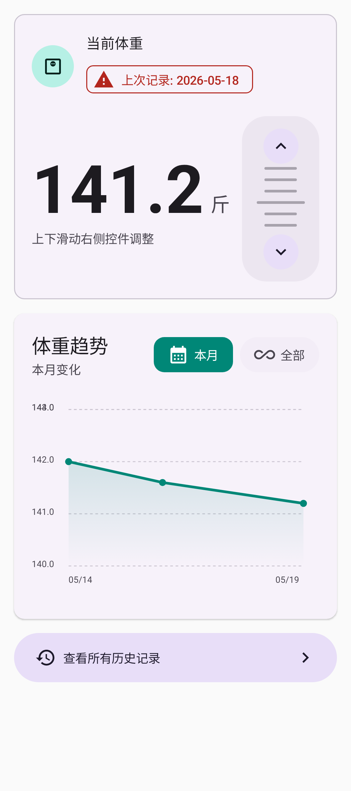

# Weight

**Reference revision** `8590e41`

## Current UI

Enter Weight through the navigation drawer. The overview shows the current weight in 斤, a vertical adjustment control, a trend card with 本月 and 全部 ranges, and a button that opens the history screen. The history uses the app's back navigation and shows timestamped entries with a delete action.

| State | What the app displays |
| --- | --- |
| Populated overview | Latest weight, a status chip for today's record or the last recorded date, trend data, and the history button. |
| First entry | The value control is ready for adjustment and the trend card has an empty state. |
| Weight adjusted | An inline button appears to record the adjusted value. |
| Refreshing | The overview shows the pull-to-refresh indicator. |
| Request failure | The app shows a snackbar with a retry action. |
| History | The list shows recorded values, dates and times, and delete buttons. The empty list directs the user back to Weight. |

## Visual reference

The checked-in **Compose Preview** renders the populated overview with sample records at **400 × 900 dp** using the light fallback palette. The preview covers the screen body. The app's navigation and wallpaper-derived dynamic color can be reviewed on a device or emulator.

## Implementation

- [WeightScreen.kt](../../app/src/main/java/app/tinks/tink/weight/WeightScreen.kt) contains the overview and history.
- [WeightControlCard.kt](../../app/src/main/java/app/tinks/tink/weight/ui/WeightControlCard.kt) contains the Material 3 current-weight card, adjustment control, and save action.
- [TrendChartCard.kt](../../app/src/main/java/app/tinks/tink/weight/ui/TrendChartCard.kt) contains the chart, range selector, and empty trend state.
- [WeightViewModel.kt](../../app/src/main/java/app/tinks/tink/weight/WeightViewModel.kt) handles refresh, adjustment, save, delete, and chart range.
- [MyApp.kt](../../app/src/main/java/app/tinks/tink/MyApp.kt) defines navigation between the overview and history. [Theme.kt](../../app/src/main/java/app/tinks/tink/ui/theme/Theme.kt) defines the app palette and dynamic color handling.
- [Screenshot fixture](../../app/src/screenshotTest/kotlin/app/tinks/tink/testing/TinkScreenshotTest.kt) defines `WeightOverviewScreenshotPreview`. [WeightScreenTest.kt](../../app/src/test/java/app/tinks/tink/weight/WeightScreenTest.kt) covers screen behavior.

## Design review

For changes to this flow, draft the affected Material 3 states in local HTML and review the smallest supported layout. Check Chinese labels, the 斤 unit, reachability of the adjustment and save controls, chart labels, and the transition between overview and history. Record the approved draft link here before implementing. Capture affected native states for the release HTML gallery after reviewing the release candidate.
